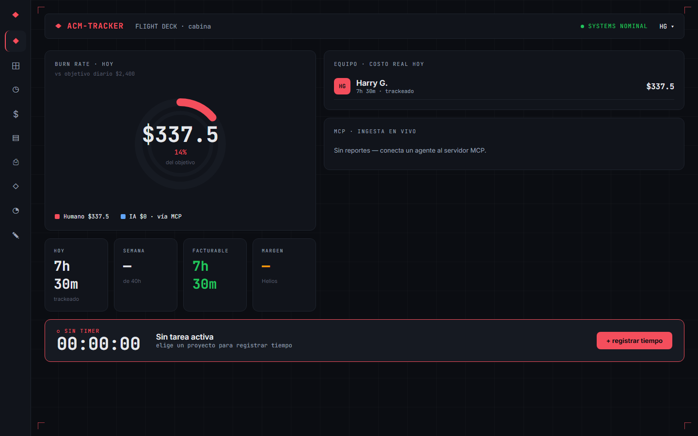
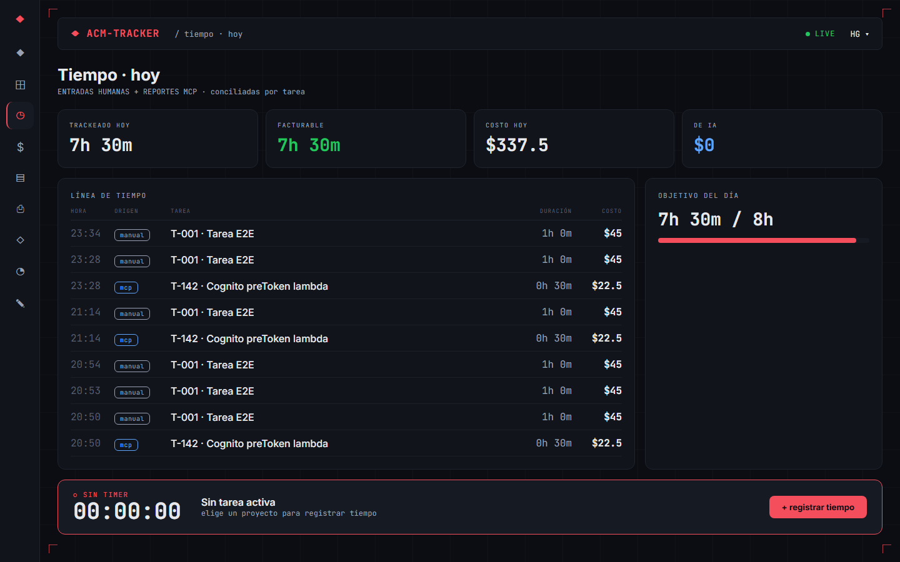
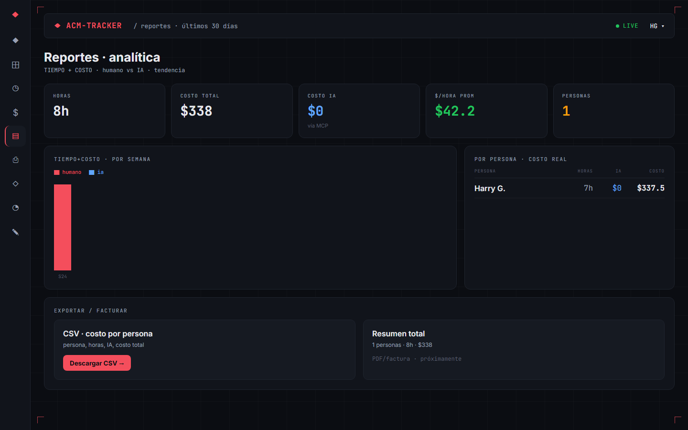

# ACM Tracker для Claude Code

Автоматический учёт времени и денег при работе с Claude Code. Видно, сколько работал агент, сколько работал ты сам, сколько задача простояла в ожидании твоего ответа и во что это обошлось в токенах — по проектам и по дням.



<p>
  
  
</p>

<sub>Скриншоты из [оригинального ACM-TRACKER](https://github.com/harrinson-gutierrez/acm-tracker): в форке добавлены статусы задач, блок «Вчера», отчёт по дням и учёт ИИ, поэтому экраны немного отличаются.</sub>

**Зачем.** Агент не знает, сколько на самом деле работал, а вручную трекать каждый диалог никто не станет. Здесь учёт идёт сам. Хук Claude Code ловит события сессии — твоё сообщение, конец ответа агента, вопрос к тебе — и пишет время и токены в трекер. Из этого складывается смета по проекту.

**Из чего собрано:**

- **Ядро — форк [ACM-TRACKER](https://github.com/harrinson-gutierrez/acm-tracker)**, open-source трекера времени и стоимости от Harrinson Gutierrez. Исходники лежат в `acm-tracker/` и запускаются локально в Docker. Форк сделан от коммита `0e95c8a` и доработан: статусы задач, итог каждого хода, ставка специалиста, учёт ИИ в смете, отчёты по дням и проектам. Полный список изменений — в `acm-tracker/MODIFICATIONS.md`.
- Хук `hooks/acm-hook.mjs` — учёт всех диалогов без участия агента: каждый диалог становится задачей в проекте по имени папки.
- Обвязка: docker-compose с данными в отдельной папке, подключение MCP, шаблоны настроек.

Трекер распространяется под лицензией AGPL-3.0 (`acm-tracker/LICENSE`), и форк — под той же лицензией.

## Что лежит в папке

| Файл | Зачем |
|------|-------|
| `docker-compose.yml` | Контейнер `acm-tracker` (веб-интерфейс и API) и служебный `data-perms`, который перед стартом выдаёт папке `data/` нужного владельца |
| `data/` | **Данные трекера**: база `acm.db` и папка `uploads`. Лежат на диске отдельно от контейнера и образа |
| `.env.example` | Порт, часовой пояс, имя и ставка владельца, папка данных. Копируется в `.env` |
| `hooks/` | **Автотрекинг всех диалогов Claude Code**: скрипт хука `acm-hook.mjs`, шаблон настроек `config.example.json`, шаблон подключения к Claude Code `claude-settings.example.json` (раздел 3) |
| `.mcp.json.example` | Шаблон подключения MCP-сервера трекера к Claude Code. Копируется в `.mcp.json` |
| `acm-tracker/` | **Ядро — трекер**: форк [ACM-TRACKER](https://github.com/harrinson-gutierrez/acm-tracker) от коммита `0e95c8a` (main, версия 0.3.0) с доработками, список — в `MODIFICATIONS.md`. Docker-образ собирается из этих исходников |

Личные файлы в git не попадают, вместо них лежат `*.example`-шаблоны: `.env`, `.mcp.json`, `hooks/config.json`, `.claude/settings.local.json`. Также не попадают данные (`data/`, `data-backup-*/`) и состояние хука (`hooks/state/`).

Образ собирается из исходников, а не берётся готовый `ghcr.io/...:0.2.0`, потому что в релизе 0.2.0 нет таймера ▶ и редактируемой дневной цели burn rate. Они появились в main уже после релиза, а нового тега автор не выпускал.

## 1. Запуск

Нужно: Docker (Docker Desktop с интеграцией WSL или Docker Engine) и Node.js 18+. Node нужен хуку и MCP-серверу, сам трекер работает в контейнере.

Все команды ниже запускаются из папки репозитория.

**Перед первым запуском (по желанию).** Владелец трекера создаётся один раз, при пустой базе. Чтобы сразу записать своё имя и ставку:

```bash
cp .env.example .env
```

В `.env` поменять `OWNER_NAME` и `OWNER_RATE_PER_HOUR`. `OWNER_EMAIL` лучше оставить `owner@acm.local`: по нему MCP-сервер привязывает записи агента. Без `.env` всё запустится с демо-владельцем «Harry G.» и ставкой $0/ч. Ставку потом можно задать в Settings → Preferences → My hourly rate.

**Запуск:**

```bash
docker compose up -d --build
```

Первая сборка занимает около 10 минут: ставятся зависимости и собираются веб и API. Образ весит около 1 ГБ. Повторные запуски без `--build` проходят за секунды. После старта контейнер ещё около 10 секунд прогоняет миграции и сид базы, потом становится `healthy`.

**Проверка:**

```bash
docker compose ps
```

В колонке STATUS должно быть `healthy`.

```bash
curl -s http://localhost:5188/api/projects
```

Должен вернуться JSON с демо-проектом Helios.

Интерфейс открывается в браузере Windows: **http://localhost:5188**.

### Команды на каждый день

Все команды запускаются из папки репозитория.

| Что | Команда |
|-----|---------|
| Запустить | `docker compose up -d` |
| Остановить (данные сохраняются) | `docker compose stop` |
| Логи | `docker compose logs -f` |
| Перезапустить | `docker compose restart` |
| Состояние | `docker compose ps` |
| Сохранить копию данных | `docker compose stop`, затем `cp -a data data-backup-$(date +%F)`, затем `docker compose start` |
| **Сбросить базу к чистому состоянию** (удаляет все данные) | `docker compose down`, затем `rm -rf data`, затем `docker compose up -d` |
| Обновить трекер с GitHub | `git -C acm-tracker pull`, затем `docker compose up -d --build` |

Контейнер поднимается сам вместе с Docker Desktop (`restart: unless-stopped`), если его не остановили вручную. Это важно: если трекер не запущен, вызов `report_work` у агента упадёт и запись потеряется.

### Где лежат данные

Все данные трекера — в папке `data/` рядом с `docker-compose.yml`:

- `data/acm.db` — вся база SQLite: проекты, задачи, записи времени, цены моделей, настройки;
- `data/uploads/` — загруженные файлы.

В контейнер папка подключена как `/data`. Контейнер и образ можно удалять и пересобирать (`docker compose down`, `docker compose up -d --build`, `docker rmi acm-tracker:local`), данные при этом останутся. Пропадут они, только если удалить саму папку `data`.

Трекер в контейнере работает от твоего пользователя (uid 1000, меняется через `ACM_UID`/`ACM_GID` в `.env`). Поэтому файлы в `data/` принадлежат тебе: их можно копировать и удалять без `sudo`. Если папку удалить, она создастся заново при следующем `docker compose up` — это и делает служебный контейнер `data-perms`. В `docker compose ps -a` он висит со статусом `Exited (0)`, так и должно быть.

Копию лучше снимать с остановленного трекера: если скопировать `acm.db` в момент записи, копия может оказаться битой.

Чтобы хранить данные в другом месте, задать путь в `ACM_DATA_DIR` в `.env`. Лучше держать их внутри файловой системы WSL: через `/mnt/c` доступ к файлам заметно медленнее.

Удалять проекты, задачи и записи трекер не умеет, поэтому почистить тестовые данные можно только сбросом базы.

Порт открыт только на `127.0.0.1`. Авторизации в трекере нет: любой, кто достучится до порта, пишет от имени владельца. Наружу в сеть его открывать не стоит.

## 2. Как это устроено

```
Claude Code (WSL)
   │  запускает как дочерний процесс, общается через stdin/stdout (MCP stdio)
   ▼
MCP-сервер  node acm-tracker/packages/claude-plugin/mcp/index.js
   │  каждый инструмент = один-два HTTP-запроса
   ▼
http://localhost:5188/api/…            ◄── браузер: http://localhost:5188
   │
   ▼
Контейнер acm-tracker: NestJS API + собранный React-фронт (одним сервером)
   │
   ▼
SQLite /data/acm.db  =  папка data/ проекта на диске WSL
```

**MCP-сервер ничего не хранит.** Это тонкий переводчик: 10 инструментов превращаются в REST-запросы к трекеру. Его запускает сам агент при старте сессии, отдельно поднимать его не нужно.

**Что происходит при `report_work`:**

1. Агент передаёт `projectName` + `taskCode` (или готовый `taskId`), `minutes`, `output`, и при желании `aiRuns` — модель и токены.
2. MCP-сервер ищет проект по имени (без учёта регистра) и задачу по коду. С `createMissing: true` создаёт недостающие, без него возвращает ошибку.
3. Сервер отправляет `POST /api/mcp/report-work` с email из `ACM_OWNER_EMAIL`.
4. API находит участника по этому email (нет такого — ошибка 404) и создаёт запись времени: источник `mcp`, всегда оплачиваемая, ставка — текущая ставка участника.
5. Для каждой модели в `aiRuns` ищет строку в таблице цен по **точному id модели** (провайдер не учитывается) и считает `токены_вход / 1M × цена_вход + токены_выход / 1M × цена_выход`. Нет строки — стоимость $0.

**Как считаются деньги:**

- Стоимость человека = `минуты / 60 × ставка`. Ставка «замораживается» в момент записи: если потом поменять ставку, старые записи не пересчитаются.
- Стоимость ИИ = сумма по моделям, каждая округляется до центов. Очень маленькие запуски могут округлиться до $0.00.
- Если агент отчитывается сам через `report_work`, его минуты считаются по ставке владельца и попадают в «человеческую» стоимость. Хуки из раздела 3 пишут время агента на отдельного участника «Claude · агент» со ставкой $0, так что этой проблемы нет.

**Таймер.** На человека одна активная сессия. Старт на другой задаче останавливает текущую и пишет по ней запись. Минуты округляются, минимум 1.

**«Сегодня», «вчера» и «неделя»** считаются по часовому поясу сервера (`ACM_TZ`, по умолчанию Europe/Moscow). В том же поясе показывается и время записей в лентах MCP и Tracker. У автора оно было в UTC, на 3 часа меньше московского, — это исправлено.

**Авторизации нет.** Каждый запрос выполняется от имени первого созданного участника (владельца).

## 3. Автотрекинг всех диалогов (хуки Claude Code)

Это основной способ учёта. Каждый диалог Claude Code становится задачей в трекере, агент в этом не участвует. Время снимают хуки Claude Code (`~/.claude/settings.json`), а скрипт `hooks/acm-hook.mjs` пишет его в трекер через API.

### Установка

1. **Подключить хук к Claude Code.** Перенести блок `hooks` из `hooks/claude-settings.example.json` в `~/.claude/settings.json` и заменить `/ABSOLUTE/PATH/TO/REPO` на абсолютный путь к этому репозиторию. Если в `~/.claude/settings.json` уже есть другие хуки, нужно объединить списки, а не заменять их.
2. **Настройки хука (по желанию).** Скопировать `hooks/config.example.json` в `hooks/config.json` и поправить под себя: свои имена проектов, лимит паузы. Без `config.json` хук работает на настройках из шаблона.
3. **Открыть новую сессию Claude Code** и написать что-нибудь — в трекере появится проект и задача (подробнее — «Как проверить» ниже).

### Что считается

| Что | На кого в трекере | Ставка | Как определяется |
|---|---|---|---|
| Агент работает | «Claude · агент» | $0 + токены | От твоего сообщения до конца ответа агента, без пауз на вопросы и разрешения |
| Ручная работа | ты (владелец) | твоя ставка | Пауза между ответом агента и твоим следующим сообщением, но не больше 30 минут. Или явно: `#вручную 20м`. Пока идёт твой таймер ▶, паузы сюда не считаются |
| Ручной таймер ▶ | ты (владелец) | твоя ставка | Ты сам запускаешь и останавливаешь таймер на задаче в трекере. Работает независимо от агента |
| Ожидание ответа («стоит») | «Ожидание ответа» | $0 | Агент задал вопрос или ждёт разрешения: часть паузы сверх 30 минут ручной работы |

Ты один на все диалоги, поэтому одна и та же минута не засчитывается тебе дважды. Если ведёшь несколько диалогов параллельно, отрезок паузы, уже записанный в одном диалоге, в другом не считается твоей работой. Если там агент ждал ответа, этот отрезок идёт в ожидание. Занятые отрезки хранятся в `hooks/state/human-claims.json`.

Пауза делится так: первые 30 минут — твоя ручная работа. Остаток считается ожиданием, если агент ждал ответа. Если задача уже была закончена, остаток не считается вовсе: ты просто ушёл. Если в паузе была пометка `#вручную`, вместо автоматических 30 минут берётся указанное время.

Токены берутся из транскрипта сессии, включая сабагентов: модель, вход и выход. Трекер знает только цену входа и выхода, поэтому кэш пересчитывается в цену обычного входа. Запись в кэш идёт ×1.25 (на 5 минут) или ×2 (на 1 час). Чтение из кэша — по доле от цены входа, своей для каждой модели: 0.025 у Fable 5.1, 0.05 у Opus 5.5 и Sonnet 5.5, 0.1 у остальных. Доли задаются в `cacheReadRatio` в `hooks/config.json` (или в шаблоне `config.example.json`, если своего файла нет). В трекере поле «входные токены» поэтому показывает не сырое число токенов, а входные токены в пересчёте на цену входа.

Цены моделей нужно занести в Settings → Model prices: id модели и цена за 1M входных и выходных токенов. По странице тарифов Anthropic на 24.10.2026: `claude-opus-5-5` — $4 / $20, `claude-opus-5` и `claude-opus-4-8` — $5 / $25, `claude-sonnet-5-5` и `claude-sonnet-5` — $2 / $10, `claude-fable-5-1` — $10 / $50. Для модели без строки в таблице стоимость будет $0. Какие модели ты реально используешь, видно в ленте MCP трекера. Это цены API: при работе по подписке Claude реальный счёт другой, а в трекере видна API-стоимость той же работы.

Ход, который запускает не твоё сообщение, а уведомление о завершении фоновой задачи (сборка, тесты), хук отличает. Пауза перед таким ходом считается временем агента, если он ждал свою задачу, или ожиданием, если до этого агент задал тебе вопрос. Ручной работой она не считается.

Время пишется целыми минутами. Остаток секунд переносится на следующий отрезок, так что ничего не теряется. Ставку агента можно поменять в Settings → Members & rates, если захочется считать его время в деньгах.

### Проект, задача, статус

- **Проект** определяется по папке, где открыт диалог: `<клиент> · <репо>`, где клиент — родительская папка. Например, `~/projects/acme/shop` превращается в «acme · shop». Для git-репозитория берётся корень основного репо, даже если диалог идёт в worktree. Проект создаётся сам при первом сообщении. Своё имя для папки задаётся в `projectNames` в `hooks/config.json` по абсолютному пути, например `{"/home/you/projects/acme/shop": "AG · Acme · Магазин"}`.
- **Задача** — это один диалог. Код — `S-` и первые 8 символов id сессии, название — заголовок диалога в приложении (или первое сообщение). Под названием показываются **summary** — итог последнего хода агента — и ветка git.
- **Summary** хук берёт в конце каждого ответа агента. В приложении это 2–3 предложения из блока следующего шага, в терминале — первый абзац последнего ответа, до 400 символов. Итог хода пишется в заметку к записи времени агента. Поэтому на вкладке Time проекта и в ленте Tracker видна история: что делалось на каждом ходу и сколько это заняло. У задачи хранится последний итог.
- **Продолжение старого диалога** создаёт задачу на первом новом сообщении, в проекте по папке, где диалог начинался. Время и токены считаются с этого момента. Если диалог уже есть в трекере, открывается та же задача.
- **Ответвление диалога** — fork или правка своего старого сообщения, в заголовке появляется «(fork)» — приложение создаёт как новую сессию с копией истории. Хук узнаёт её по общим сообщениям с исходным диалогом и продолжает ту же задачу. Пауза отсчитывается от последнего ответа агента в исходном диалоге, токены скопированной истории повторно не считаются. Если потом вернуться в старую ветку, пауза там отсчитывается от последней активности в ответвлении.
- **Статус** виден в колонке Status списка задач проекта:

| Статус | Когда |
|---|---|
| agent working | Агент работает над ответом |
| waiting for you | Агент задал вопрос, ждёт разрешения или выбора |
| done | Агент закончил ответ без вопроса: выводы сделаны, процесс остановлен |
| on hold | Ты поставил `#холд` |

Новое сообщение в закрытый или отложенный диалог снова открывает задачу: статус возвращается в agent working.

Статус «ждёт ответа» хук определяет по концу ответа агента: вопрос в блоке следующего шага приложения или последняя фраза со знаком «?». Иначе ставится done.

### Команды в сообщении

| Команда | Что делает |
|---|---|
| `#вручную 20м` (также `1ч30м`, `90`, `#manual 20m`) | Записать ручное время в эту задачу. Заменяет автоматический подсчёт паузы |
| `#холд` / `#hold` | Поставить задачу на холд. Пауза на холде не считается |
| `#готово` / `#done` | Закрыть задачу, даже если агент задал вопрос |
| `#нетрек` / `#notrack` или фраза «не трекай эту задачу» | Перестать трекать этот диалог |
| `#трек` / `#track` | Снова включить трекинг |

Если сообщение состоит только из команд, оно не уходит агенту: хук его принимает и показывает подтверждение «ACM-трекер: …». Если в сообщении есть и обычный текст, агент получит его как всегда, а команда тоже применится. Команды срабатывают в любом месте сообщения, поэтому случайно писать их в тексте не стоит.

Если сказать «не трекай» в первом же сообщении, задача даже не создастся. Всё, что записано до команды, остаётся в трекере: удалять записи он не умеет.

### Где что лежит

- `hooks/acm-hook.mjs` — сам скрипт.
- `hooks/config.json` — адрес трекера, лимит ручной паузы (`manualCapMinutes`), служебные участники, свои имена проектов, выключатель `enabled`. В git не попадает. Если его нет, хук читает шаблон `hooks/config.example.json`.
- `hooks/claude-settings.example.json` — шаблон блока `hooks` для `~/.claude/settings.json`.
- `hooks/state/` — состояние диалогов, кэш id, очередь неотправленных записей `queue.jsonl` и лог ошибок `hook.log`.
- `~/.claude/settings.json` — подключение хука к событиям Claude Code.

**Если трекер выключен**, записи копятся в `hooks/state/queue.jsonl` и уходят при следующем событии любого диалога, как только трекер снова доступен.

**Хук подхватывается не мгновенно.** В новых сессиях он работает сразу. В уже открытой сессии приложения он заработал со следующего хода после установки. Если какой-то открытый диалог в трекере не появляется — перезапустить его. Если хук подключился посреди диалога, учёт начнётся с этого момента, а прошлое время диалога не считается.

**Выключить:** поставить `"enabled": false` в `hooks/config.json` (действует сразу) или убрать блок `hooks` из `~/.claude/settings.json`.

**Не включай вместе с хуком отчёты агента через `report_work`** — ни плагин со скиллом, ни правило в `CLAUDE.md` из раздела 6. Иначе время агента посчитается дважды. MCP-сервер из `.mcp.json` оставлять можно: агент вызывает его инструменты только по просьбе, например чтобы показать проекты или сводку за день.

### Ручной таймер и твоя ставка

Твоя ставка как специалиста задаётся в **Settings → Preferences → My hourly rate**. По умолчанию $0. Это та же ставка, что у владельца в Members & rates: изменишь в одном месте — поменяется и в другом.

Таймер — это человеческое время:

1. Нажимаешь ▶ у задачи в проекте или Start timer в нижней панели и выбираешь задачу.
2. Таймер идёт, пока ты сам не нажмёшь STOP. Агент, хук и смена статусов задач на него не влияют.
3. После STOP появляется запись с пометкой **human · timer**, на тебя, по твоей ставке на момент записи.

Таймер один на человека. Старт на другой задаче останавливает текущий и сразу записывает время по нему, так устроен сам трекер.

Пока таймер идёт, хук не добавляет автоматическое ручное время за паузы, чтобы твоё время не посчиталось дважды. Проверяется момент твоего следующего сообщения: если таймер к этому моменту остановлен, пауза считается как обычно. Явная пометка `#вручную` работает всегда.

В ленте Tracker источник записи подписан: зелёным — **human · manual** и **human · timer** (ты), синим — **auto · mcp** (агент и ожидание). В колонке **Who** видно, на кого записано.

Ставка «замораживается» в записи. Если поменять её позже, старые записи останутся по прежней ставке.

### Экран Time: сегодня и вчера

Сверху — **Timeline** за сегодня, как и раньше. Под ним — блок **Yesterday** с записями за вчерашний день. В заголовке блока итог за вчера: дата, всё время, стоимость времени и стоимость ИИ. Колонки те же, что в Timeline: время, источник (human/auto), кто, задача с итогом хода и длительность. Сутки начинаются в 00:00 по московскому времени. Записи за любой день без интерфейса: `GET /api/time-entries/day?date=2026-10-24`.

### Отчёты по проектам и дням

В **Reports** сверху есть выбор проекта. «All projects» — всё вместе, конкретный проект — только он. От выбора зависят все блоки страницы:

- **Плитки:** всё время (агент, ожидание и ты), полная стоимость с разбивкой «человек / ИИ», стоимость ИИ, средняя стоимость часа, число участников со временем;
- **график по неделям** — стоимость времени и ИИ;
- **таблица по людям** — время в часах и минутах, стоимость ИИ и итог;
- **таблица по дням** за последние 30 дней:
  - сколько в этот день было твоего времени (Human), времени агента (Agent) и ожидания ответа (Waiting), общий итог, стоимость ИИ и стоимость времени;
  - под датой — задачи этого дня, от больших к меньшим, с временем по каждой. При «All projects» рядом с задачей указан проект.

День определяется по московскому времени (`ACM_TZ`). Агент и ожидание различаются по служебным участникам, которых заводит хук: «Claude · агент» и «Ожидание ответа». Всё остальное считается твоим временем. Те же данные без интерфейса: `GET /api/reports/daily?days=30&projectId=<id>`.

### Правки в трекере

Трекер в `acm-tracker/` — форк [оригинала](https://github.com/harrinson-gutierrez/acm-tracker) от коммита `0e95c8a`. Чтобы всё описанное выше работало, в него внесены правки (кратко по-английски — в `acm-tracker/MODIFICATIONS.md`):

- `packages/shared/src/types.ts`, `apps/api/src/modules/tasks/...` (DTO, маппер, порт), `apps/api/src/modules/projects/infrastructure/persistence/project.mapper.ts` — статусы `waiting` и `hold`, поле `summary` у задачи;
- `apps/api/prisma/schema.prisma`, `apps/api/prisma/sqlite/schema.prisma` и миграции `20261024120000_add_task_summary` — колонка `summary` в таблице задач;
- `apps/api/src/modules/time-entries/...` — заметка и имя участника в лентах записей;
- `apps/web/src/screens/ProjectDetail.tsx`, `Tracker.tsx`, `Settings.tsx`, `features/time-entries/...`, `i18n/locales/en.json`, `es.json` — колонка статуса, summary и ветка под названием задачи, заметки в лентах, колонка Who, пометки human/auto, настройка My hourly rate. Заодно убран вшитый подзаголовок «Plataforma fintech», который показывался у любого проекта;
- `apps/api/src/modules/reporting/...` — стоимость ИИ в расчёте по проекту (карточка проекта, вкладки Summary и Costs, MCP-инструмент `project_cost`) и по людям (вкладка Team, Reports → By person). У автора там всегда стоял $0. Маржа проекта теперь считается от полной стоимости, человек плюс ИИ, а не только от человеческой;
- `apps/api/src/modules/reporting/...` и `apps/web/src/screens/Reports.tsx`, `features/reporting/...` — отчёт по дням `GET /reports/daily`, фильтр по проекту для отчётов по неделям и по людям, стоимость ИИ в недельном графике. На странице Reports: выбор проекта, таблица по дням, исправленные плитки — раньше «AI» и «Total cost» показывали $0 при ненулевой стоимости ИИ;
- `apps/api/src/modules/time-entries/...`, `packages/shared/src/time.ts`, `apps/web/src/screens/Tracker.tsx`, `features/time-entries/components/...` — эндпоинт записей за любой день `GET /time-entries/day`, блок Yesterday на экране Time, местное время вместо UTC в лентах Tracker и MCP;
- тесты API обновлены под новые поля, добавлены тесты на учёт ИИ в стоимости проекта, на разбивку по дням и на работу с датами. Все 37 тестов API, 12 тестов shared, тесты фронтенда и проверка расхождения схем проходят.

**Если меняешь трекер**, правь файлы в `acm-tracker/` и пересобирай образ: `docker compose up -d --build`. Существенные изменения стоит дописывать в `MODIFICATIONS.md` — лицензия AGPL требует отмечать, что код изменён.

**Обновления от автора** вручную переносятся из [оригинального репозитория](https://github.com/harrinson-gutierrez/acm-tracker): всё, что у автора появилось после `0e95c8a`. Перед обновлением с миграциями стоит сохранить копию `data/`.

После пересборки браузер может показывать старую версию интерфейса из кэша: трекер устроен как PWA. Помогает обновить страницу через Ctrl+Shift+R.

### Как проверить

1. Открыть **новую** сессию Claude Code в любой папке и что-нибудь написать.
2. В трекере появится проект по имени папки, а в нём задача с заголовком диалога в статусе agent working. После ответа статус станет done или waiting for you.
3. На вкладке Team проекта видна разбивка: «Claude · агент», «Ожидание ответа» и ты.
4. Если ничего не появилось — смотреть `hooks/state/hook.log`.

## 4. Подключение MCP

MCP-сервер нужен, чтобы агент мог по просьбе смотреть и менять данные трекера. Время с ним считать не нужно, это делают хуки из раздела 3.

Выбрать **один** из вариантов. Если включить два сразу, у агента окажутся два сервера `acm-tracker` с одинаковыми инструментами.

### Вариант A — только в этой папке

1. Скопировать `.mcp.json.example` в `.mcp.json` и заменить `/ABSOLUTE/PATH/TO/REPO` на абсолютный путь к этому репозиторию.
2. По желанию создать `.claude/settings.local.json` с содержимым `{"enabledMcpjsonServers": ["acm-tracker"]}` — тогда Claude Code не будет спрашивать подтверждение для этого сервера.
3. Открыть **новую** сессию Claude Code в папке репозитория. Уже открытые сессии сервер не увидят: MCP-серверы подключаются при старте сессии. Если Claude Code спросит, разрешать ли проектный сервер `acm-tracker`, — разрешить.

Оба файла личные, в git не попадают.

Проверка: попросить агента «покажи проекты в трекере». Он должен вызвать `list_projects` и вывести Helios.

Чтобы тестировать в другом репозитории, скопировать туда `.mcp.json` и `.claude/settings.local.json`: путь к серверу в `.mcp.json` абсолютный и работает из любой папки.

Скилла `report-work` в этом варианте нет, поэтому сам агент отчитываться не будет. С хуками из раздела 3 так и должно быть.

### Вариант B — во всех проектах

Тот же сервер, но в пользовательских настройках Claude Code (`~/.claude.json`). Нужен CLI `claude` в WSL. Сейчас его нет в PATH: приложение Claude запускает свою копию. Можно поставить CLI или попросить Claude в любой сессии выполнить это за тебя. Команда:

```bash
claude mcp add --scope user acm-tracker -e ACM_API_URL=http://localhost:5188 -e ACM_OWNER_EMAIL=owner@acm.local -- node /ABSOLUTE/PATH/TO/REPO/acm-tracker/packages/claude-plugin/mcp/index.js
```

После этого `.mcp.json` и `.claude/settings.local.json` из этой папки стоит удалить, чтобы не было дубля. Правило отчёта тоже нужно прописывать в `CLAUDE.md`.

### Вариант C — плагин автора (MCP + скилл + `/acm-status`)

> **Вместе с хуками из раздела 3 не ставить:** скилл плагина заставит агента отчитываться сам, и время посчитается дважды.

Плагин даёт тот же MCP-сервер плюс скилл `report-work`, который сам напоминает агенту отчитаться после законченной работы, и команду `/acm-status`. Плагин по умолчанию ходит на `http://localhost:5188` — порт контейнера выбран под это, переменные задавать не нужно.

В Claude Code в терминале:

```
/plugin marketplace add harrinson-gutierrez/acm-tracker
/plugin install acm-tracker@acm-tracker
```

Или то же самое командами CLI:

```bash
claude plugin marketplace add harrinson-gutierrez/acm-tracker
```

```bash
claude plugin install acm-tracker@acm-tracker
```

Потом перезапустить Claude Code. Если в приложении команда `/plugin` недоступна, использовать команды CLI (тоже нужен `claude` в PATH, см. вариант B). При этом варианте `.mcp.json` и `.claude/settings.local.json` из этой папки нужно удалить.

На экране **MCP** в интерфейсе трекера есть подсказка с готовым JSON для подключения. В Docker-сборке путь к серверу в ней пустой, и трекер предупреждает об этом. Это нормально: путь брать из `.mcp.json`.

### Вариант D — чаты в приложении Claude на Windows (не проверено)

Приложение Claude на Windows запускает MCP-серверы на стороне Windows. Сервер можно запустить внутри WSL через `wsl.exe`. В `%APPDATA%\Claude\claude_desktop_config.json`:

```json
{
  "mcpServers": {
    "acm-tracker": {
      "command": "wsl.exe",
      "args": [
        "env", "ACM_API_URL=http://localhost:5188", "ACM_OWNER_EMAIL=owner@acm.local",
        "node", "/ABSOLUTE/PATH/TO/REPO/acm-tracker/packages/claude-plugin/mcp/index.js"
      ]
    }
  }
}
```

Правило отчёта — в инструкциях проекта Claude.

## 5. Первая настройка трекера

Минимум для теста:

1. **Цены моделей** (Settings → Model prices). Для моделей Claude, которыми ты работаешь, уже заполнены (раздел 3). Без строки для модели её стоимость ИИ всегда $0. Id модели должен совпадать посимвольно с тем, что агент передаёт в `aiRuns.model`. Цены брать со страницы тарифов Anthropic. Можно попросить агента: «добавь в трекер цену модели <id>: <цена> за 1M входных и <цена> за 1M выходных токенов» — он вызовет `set_model_price`.
2. **Своя ставка** (Settings → Members & rates), если не задал её в `.env` до первого запуска.
3. **Дневная цель** (Settings → Preferences). По умолчанию $2400, от неё рисуется кольцо burn rate.

Через MCP-инструмент `create_project` можно передать только имя, клиента и сумму контракта. Ставку и оценку в часах при создании принимает только API:

```bash
curl -s -X POST http://localhost:5188/api/projects -H 'Content-Type: application/json' -d '{"name":"ME · Pet project","client":"Личное","estimateHours":40,"ratePerHour":0}'
```

Потом их можно поправить в карточке проекта.

## 6. Правило отчёта для агента (только без хуков)

Нужно, только если хуки из раздела 3 выключены. Вместе с хуками это правило даёт двойной учёт. Для вариантов A, B и D агент сам не знает, что нужно отчитываться. Блок для `CLAUDE.md` репозитория (для Codex — `AGENTS.md`):

```markdown
## Учёт времени (ACM-TRACKER)
- projectName: "AG · Acme · Сайт" — использовать ровно это имя, не придумывать своё
- taskCode: ключ задачи из имени ветки (например ACME-123); если ветки нет — спросить один раз
- После каждого законченного этапа вызывать report_work с createMissing: true
- output: одна строка, что сделано, без кода и бизнес-деталей
- Токены не выдумывать: если точных цифр нет, aiRuns не передавать
```

## 7. Тестовый прогон отчётов агента (без хуков)

Проверка хуков описана в разделе 3. Здесь — проверка режима, в котором агент отчитывается сам.

1. `docker compose ps` показывает `healthy`, `curl -s http://localhost:5188/api/projects` возвращает JSON.
2. Открыть новую сессию Claude Code в тестовой папке, где есть `.mcp.json` (или подключён вариант B/C) и блок из раздела 6.
3. Попросить: «покажи проекты в трекере». Агент вызывает `list_projects`.
4. Засечь время по часам и дать агенту небольшую задачу.
5. В конце агент вызывает `report_work`. Вызов виден в беседе, в ответе — `Recorded N min on task <id>. AI cost: $…`. Если трекер выключен, придёт ошибка `fetch failed`, и запись не сохранится.
6. В браузере: экран **MCP** (обновляется раз в 5 секунд) и лента **Tracker** с меткой `mcp` под нужным проектом.
7. Сравнить заявленные минуты с реальными.
8. Если стоимость ИИ $0 — проверить, есть ли в Model prices строка с тем же id модели и передал ли агент токены.
9. Включить таймер ▶ на задаче, через пару минут остановить. В ленте появится запись с меткой `timer`.
10. После тестов при желании сбросить базу: `docker compose down`, `rm -rf data`, `docker compose up -d`. Если тестовые данные ещё пригодятся, сначала сохранить копию папки `data`.

Сырые данные без интерфейса:

```bash
curl -s http://localhost:5188/api/mcp/reports
```

```bash
curl -s http://localhost:5188/api/time-entries/today
```

## 8. Подводные камни

- **Отчёты агента через `report_work` теряются, если трекер выключен**: MCP-сервер их не копит. Хуки копят записи в очереди и отправляют позже.
- **В `report_work` минуты — оценка самого агента**, а не секундомер. Хуки меряют реальное время по событиям.
- **Свои токены агент обычно не знает**, и кэш в `report_work` не учитывается. Хуки берут токены из транскрипта вместе с кэшем.
- **Ручное время в хуках — приближение.** Пауза до 30 минут считается твоей работой, даже если ты отошёл. Точнее — пометка `#вручную`.
- **Время диалога до подключения хука не считается**: учёт идёт с первого хода после установки.
- **Выручка проекта** (ставка проекта × часы) **берёт все часы проекта**: агента, ожидание и твои. Если клиент платит только за часть из них, выручку и маржу в карточке проекта нужно читать с этой поправкой.
- **Не везде учтён ИИ.** Он есть в карточке проекта, на вкладке Team, в Reports и в сводке за сегодня. В общей плитке маржи на главной ИИ по-прежнему $0, как у автора: это место не правилось.
- **Часы в отчётах трекера складывают агента, ожидание и ручную работу.** Деньги считаются отдельно: агент и ожидание идут по $0. Чтобы видеть виды времени по отдельности, смотри вкладку Team проекта или Reports → By person.
- **Удаления нет** — ни через интерфейс, ни через API. Тестовые проекты останутся до сброса базы.
- **Имя и ставка из `.env` применяются только к пустой базе.** Потом — только через Settings.
- **Смена `OWNER_EMAIL`** требует той же правки в `ACM_OWNER_EMAIL` у MCP-сервера, иначе `report_work` вернёт 404.
- **Пауза записывается в день, когда она началась.** Если агент ответил в 23:50, а ты ответил в 00:20, твои 30 минут ручной работы окажутся во вчерашнем блоке: запись начинается в 23:50.
- **Цена модели ищется только по точному id**, провайдер в расчёте не участвует. Id с суффиксом даты и без него — разные строки, нужна та, которую передаёт агент.

## 9. Что проверено при сборке (24.10.2026)

Хуки:

- Сценарий с подменённым временем: два ответа агента, вопрос через AskUserQuestion, вопрос в конце ответа, блок следующего шага с вопросом, `#вручную 15м`, `#холд`, возврат к работе, `#нетрек`. Итог совпал с расчётом: агент 30 мин, ручная работа 55, ожидание 20, статусы done → waiting → hold → done.
- Хук, подключённый посреди сессии, начинает учёт с последнего сообщения.
- Прерванный ответ без события Stop: время агента считается до последнего действия, остаток — как пауза.
- При выключенном трекере записи уходят в очередь, при следующем событии отправляются.
- Токены: повторы одного запроса не дублируются, кэш пересчитывается в цену входа, стоимость совпала с ручным расчётом.
- Настоящий Claude Code CLI с пользовательскими настройками: хук создал проект «клиент · репо» по папке, задачу с веткой, статус done после Stop. Сообщение `#вручную 5м` не ушло агенту и дало 5 минут ручного времени.
- Колонка статуса и ветка видны в интерфейсе. После проверок база сброшена.
- В приложении Claude хук подхватился и в уже открытой сессии — со следующего хода: создались проект по папке и задача с заголовком диалога, дальше время и статусы пишутся как в новых сессиях.

Трекер и MCP:

- Образ собран из коммита `0e95c8a`, контейнер `healthy`, API отвечает из WSL и из Windows (`http://localhost:5188`), веб-интерфейс открывается.
- MCP-сервер из `.mcp.json` запускается на Node 18+ в WSL и отдаёт все 10 инструментов.
- `report_work` с `createMissing: true` создаёт проект и задачу. Повторный вызов находит их без учёта регистра. Стоимость ИИ считается по таблице цен; модель без цены даёт $0. Без `createMissing` для несуществующего проекта возвращается ошибка.
- Таймер: старт и стоп через API пишут запись с меткой `timer`, минимум 1 минута.
- Через API проект создаётся сразу со ставкой и оценкой в часах.
- Данные лежат в `data/` и переживают удаление контейнера: после `docker compose down` и нового `up` трекер показывает те же проекты и настройки. Файлы базы принадлежат текущему пользователю (`ACM_UID`/`ACM_GID`), запись идёт от него же.
- Если папку `data` удалить, при следующем `up` она создаётся заново с правильным владельцем, а база — с демо-данными.
- `claude mcp list` видит проектный сервер `acm-tracker`. Подключение в новой сессии приложения Claude после этой проверки ещё не проверялось.
